<p align="center">
  
</p>

<p align="center">
  
  
  
  
  
</p>

# AutoAid

**AutoAid is a roadside-assistance app.** When a car breaks down, the driver sends a request from their phone; nearby, verified providers (tow trucks, mechanics, roadside helpers) see it, one accepts, and the driver follows the provider live on a map, chats with them, pays, and leaves a rating.

It started as a graduation project at the Faculty of Computers and Information Systems, Sadat Academy (2023-2024), where the analysis and design were done (use cases, class diagram, ERD, sequence and activity diagrams). This repository is a working implementation of that design with **Flutter**, **Firebase** and **OpenStreetMap**.

## Contents

- [The problem](#the-problem)
- [Screens](#screens)
- [Features](#features)
- [How a request works](#how-a-request-works)
- [Architecture](#architecture)
- [Data model](#data-model)
- [Security rules](#security-rules)
- [Project structure](#project-structure)
- [Getting started](#getting-started)
- [Try the full flow](#try-the-full-flow)
- [Testing](#testing)
- [Design](#design)
- [From the design documents to the code](#from-the-design-documents-to-the-code)
- [Known limitations](#known-limitations)
- [Roadmap](#roadmap)
- [Credits](#credits)

## The problem

A breakdown on a highway at night is stressful and unsafe, and finding a trustworthy mechanic or tow truck quickly, especially outside working hours or in an unfamiliar area, is slow and unreliable. AutoAid connects stranded drivers with nearby, verified providers, shows who is coming and how far away they are, and keeps the whole conversation and payment in one place.

## Screens

> These are **UI mockups** of the app's screens (dark theme, crimson accent), generated from the design the code implements. Replace them with real screenshots once you run the app.

<table>
  <tr>
    <td align="center">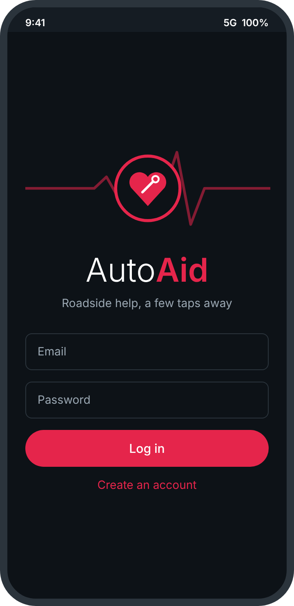<br><sub><b>Login</b></sub></td>
    <td align="center">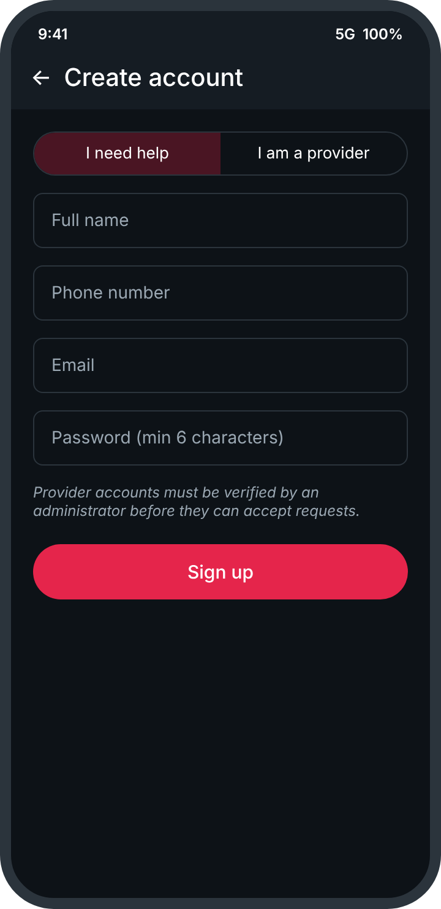<br><sub><b>Register (customer or provider)</b></sub></td>
    <td align="center">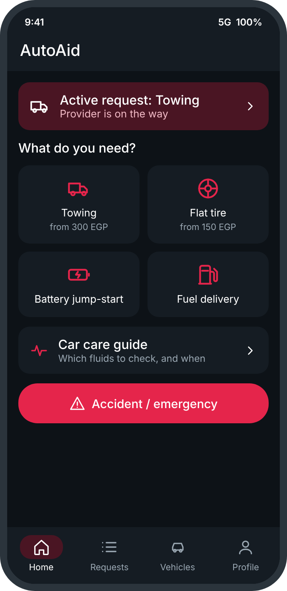<br><sub><b>Customer home</b></sub></td>
  </tr>
  <tr>
    <td align="center">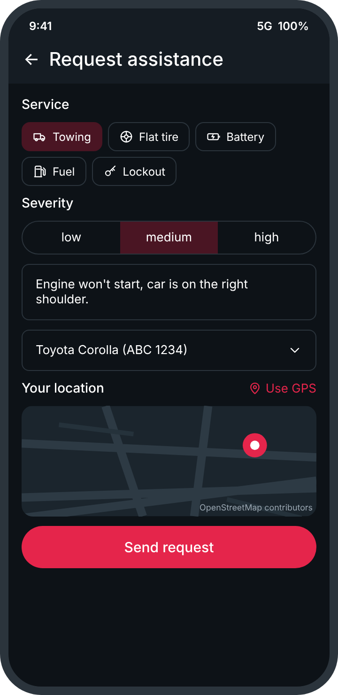<br><sub><b>Request assistance</b></sub></td>
    <td align="center">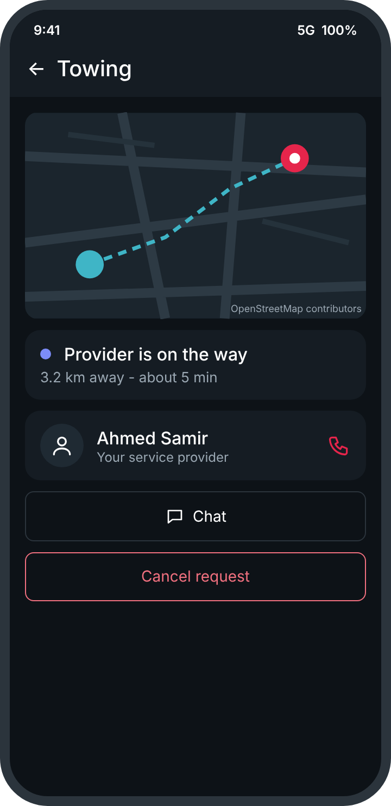<br><sub><b>Live tracking</b></sub></td>
    <td align="center">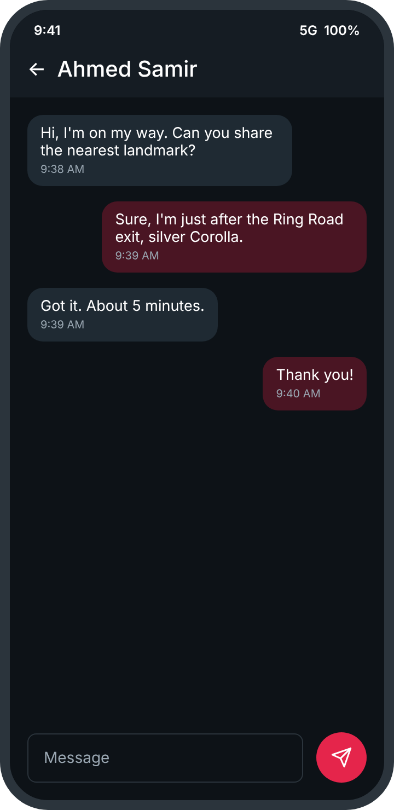<br><sub><b>In-app chat</b></sub></td>
  </tr>
  <tr>
    <td align="center">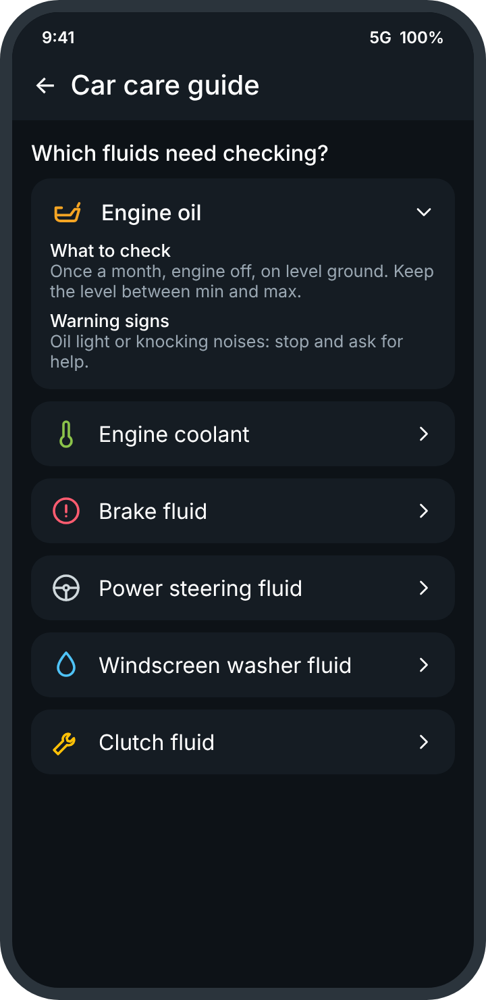<br><sub><b>Car care guide</b></sub></td>
    <td align="center">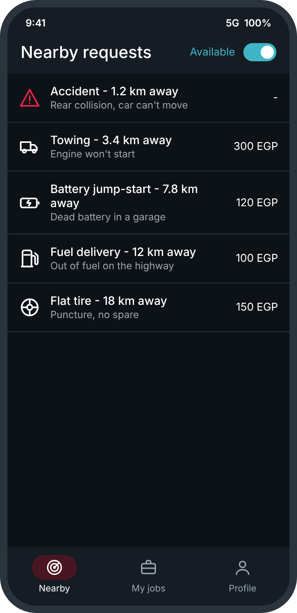<br><sub><b>Provider: nearby requests</b></sub></td>
    <td align="center">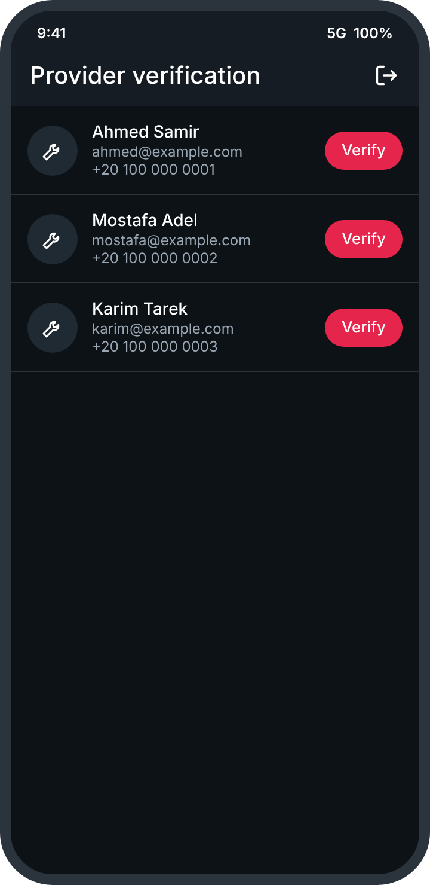<br><sub><b>Admin: verify providers</b></sub></td>
  </tr>
</table>

## Features

### Customer

| Feature | Details |
|---|---|
| Account | Register and log in with email and password, profile screen, sign out |
| Vehicles | Save cars with model, license plate, insurance and registration info |
| Request assistance | Towing, flat tire, battery jump-start, fuel delivery, lockout help, engine problem, accident |
| Location | Detected by GPS, or pick it by tapping the OpenStreetMap map |
| Request details | Severity (low, medium, high), description, optional vehicle, estimated price |
| Live tracking | The provider's position on the map, distance to you and estimated arrival time |
| Communication | In-app chat and one-tap call to the provider |
| Cancel | Cancel while the request is pending, accepted or on the way |
| Payment | Cash or wallet/Visa (simulated, see [limitations](#known-limitations)) |
| Rating | 1-5 stars and written feedback, which updates the provider's average rating |
| Emergency | Emergency numbers with one-tap call, plus an accident report that is sent to providers |
| Car care guide | Which fluids to check (oil, coolant, brake, power steering, washer, clutch), what to look for and warning signs |

### Service provider

| Feature | Details |
|---|---|
| Verification | New provider accounts must be verified by an administrator before they can accept requests |
| Availability | Available / offline switch |
| Nearby requests | Open requests within 50 km, nearest first, with distance and price |
| Accept | First provider to accept gets the job (atomic Firestore transaction) |
| Job progress | Accepted, on my way, arrived, completed |
| Live location | GPS position is shared with the customer while the job is active |
| Communication | Chat with and call the customer |
| Reputation | Average rating and number of ratings on the profile |

### Administrator

| Feature | Details |
|---|---|
| Provider verification | List of providers waiting for approval, verify with one tap |

## How a request works

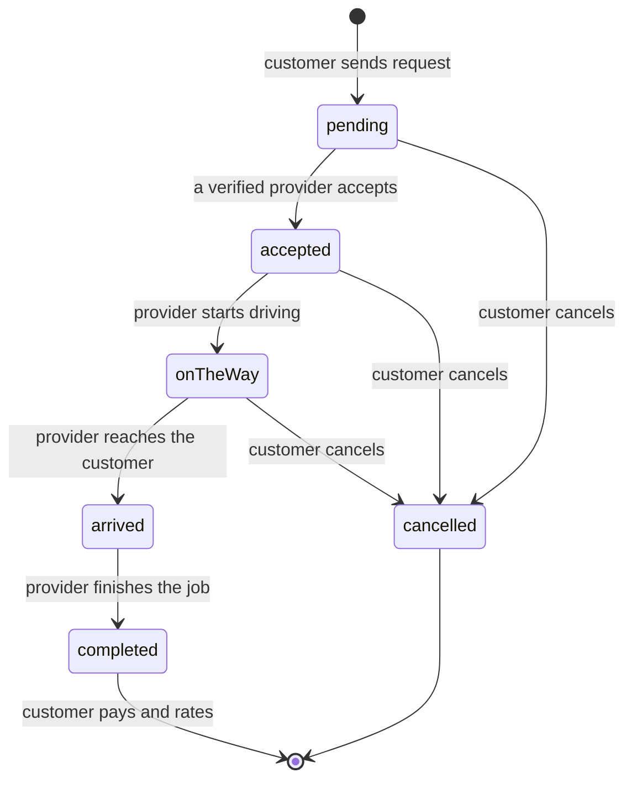

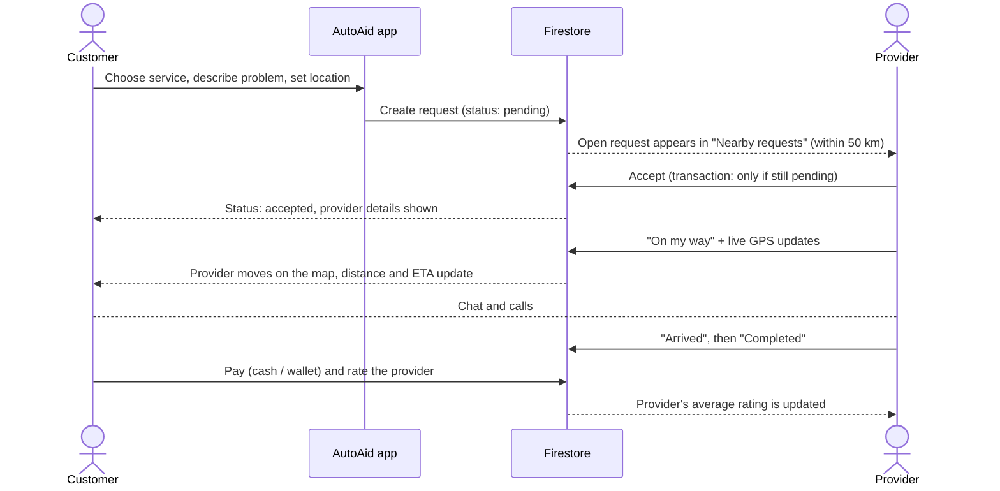

## Architecture

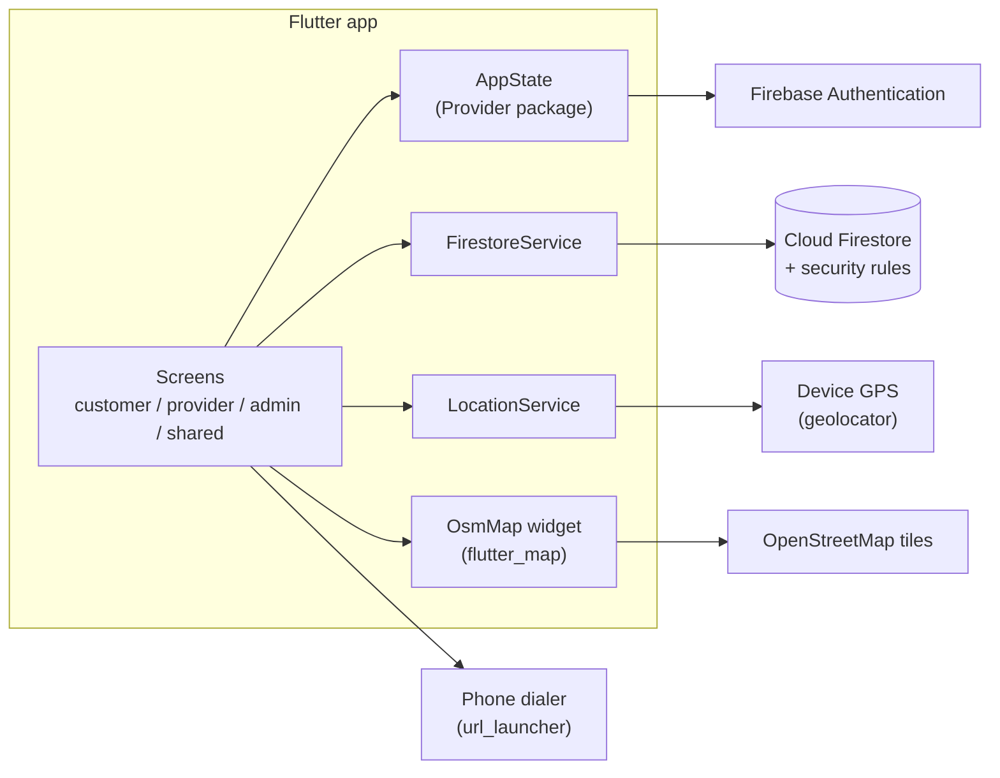

| Layer | Technology |
|---|---|
| UI | Flutter (Material 3), Dart 3 |
| State | `provider` (`AppState` holds the signed-in user and profile; everything else is read through Firestore streams) |
| Authentication | Firebase Authentication (email and password) |
| Database | Cloud Firestore with real-time listeners |
| Maps | `flutter_map` with OpenStreetMap tiles, `latlong2` for distances |
| Location | `geolocator` (one-off position and live stream) |
| Calls | `url_launcher` (`tel:` links) |
| Tests | `flutter_test` |

## Data model

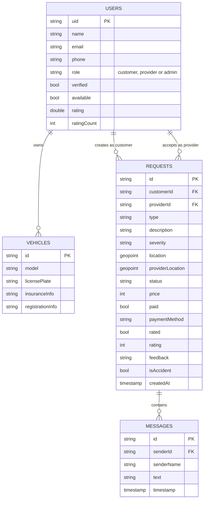

Firestore layout: `users/{uid}`, `users/{uid}/vehicles/{id}`, `requests/{id}`, `requests/{id}/messages/{id}`. Customer and provider names and phone numbers are copied into the request so the other side can show them without reading another user's document.

### Services and prices

Defined in `lib/core/constants.dart` (estimates, in EGP; accident pricing is agreed on site):

| Service | Estimated price |
|---|---|
| Towing | 300 |
| Flat tire | 150 |
| Battery jump-start | 120 |
| Fuel delivery | 100 |
| Lockout help | 130 |
| Engine problem | 200 |
| Accident | agreed on site |

## Security rules

`firestore.rules` enforces the important constraints on the server, not just in the app:

| Collection | Rule |
|---|---|
| `users` | Anyone signed in can read. New accounts can only be `customer` or `provider`, unverified, with rating 0. Owners can edit name, phone and availability only. Only an admin can set `verified`. |
| `users/{uid}/vehicles` | Only the owner can read and write. |
| `requests` | Readable by the customer, the assigned provider, anyone while the request is `pending`, and admins. Created only by the customer, as `pending` and unpaid. |
| `requests` updates | The customer can cancel, pay and rate. A **verified** provider can accept a **pending** request for themselves. The assigned provider can change status and live location. Nobody can change other fields. |
| `requests/{id}/messages` | Only the request's customer and provider can read and write. |

See [Known limitations](#known-limitations) for the one rule that is intentionally loose.

## Project structure

```
autoaid-app/
├── lib/
│   ├── main.dart                     # Firebase init, providers, AuthGate (routes by role)
│   ├── firebase_options.dart         # placeholder, replaced by `flutterfire configure`
│   ├── core/
│   │   ├── constants.dart            # service types, prices, emergency numbers
│   │   ├── models.dart               # AppUser, Vehicle, AssistanceRequest, ChatMessage
│   │   ├── theme.dart                # dark theme and colors
│   │   └── utils.dart                # call helper, snackbars, validators
│   ├── services/
│   │   ├── app_state.dart            # auth + signed-in profile
│   │   ├── firestore_service.dart    # all Firestore access
│   │   └── location_service.dart     # GPS, distance, ETA
│   ├── widgets/
│   │   ├── osm_map.dart              # OpenStreetMap widget and pin markers
│   │   └── pulse_header.dart         # logo (heart + ECG line), drawn in code
│   └── screens/
│       ├── auth/                     # login, register
│       ├── customer/                 # home, request form, vehicles, emergency, car care
│       ├── provider/                 # nearby requests, my jobs
│       ├── admin/                    # provider verification
│       └── shared/                   # request detail and tracking, chat, profile
├── test/location_service_test.dart
├── firestore.rules
├── docs/screenshots/                 # UI mockups used in this README
└── pubspec.yaml
```

## Getting started

### Prerequisites

- [Flutter SDK](https://docs.flutter.dev/get-started/install) (Dart 3.3 or newer)
- A free [Firebase](https://console.firebase.google.com) project
- [Node.js](https://nodejs.org) (needed once, for the Firebase CLI)
- Chrome (quickest way to run), or an Android emulator / device

Check your setup with `flutter doctor`.

### 1. Generate the platform folders

The repository contains the Dart code only. Generate the platform folders:

```bash
flutter create . --platforms=web,android,ios --project-name autoaid --org com.yourname
rm test/widget_test.dart      # default test created by flutter create (Windows: del test\widget_test.dart)
flutter pub get
```

### 2. Set up Firebase

In the [Firebase console](https://console.firebase.google.com):

1. **Create a project.**
2. **Authentication** -> Sign-in method -> enable **Email/Password**.
3. **Firestore Database** -> Create database.
4. Open the **Rules** tab, paste the contents of [`firestore.rules`](firestore.rules), and publish.

Then connect the app to the project:

```bash
npm install -g firebase-tools
firebase login
dart pub global activate flutterfire_cli
flutterfire configure
```

`flutterfire configure` overwrites `lib/firebase_options.dart` with your project's settings. If the `flutterfire` command is not found, add the Dart pub cache to your PATH (`%LOCALAPPDATA%\Pub\Cache\bin` on Windows, `~/.pub-cache/bin` on macOS and Linux).

### 3. Platform permissions

**Android** - `android/app/src/main/AndroidManifest.xml`, inside `<manifest>` and above `<application>`:

```xml
<uses-permission android:name="android.permission.INTERNET"/>
<uses-permission android:name="android.permission.ACCESS_FINE_LOCATION"/>
<uses-permission android:name="android.permission.ACCESS_COARSE_LOCATION"/>
<queries>
  <intent>
    <action android:name="android.intent.action.DIAL"/>
    <data android:scheme="tel"/>
  </intent>
</queries>
```

Firebase needs `minSdk` 23 or higher: in `android/app/build.gradle(.kts)` set `minSdk = 23` (or `minSdkVersion 23`).

**iOS** - `ios/Runner/Info.plist`:

```xml
<key>NSLocationWhenInUseUsageDescription</key>
<string>AutoAid needs your location to send help to you.</string>
<key>LSApplicationQueriesSchemes</key>
<array><string>tel</string></array>
```

**Web** needs nothing extra. The browser asks for location permission, and `tel:` calls do not work in a desktop browser.

### 4. Run

```bash
flutter run -d chrome        # web, quickest
flutter run                  # connected device or emulator
```

### Troubleshooting

| Problem | Fix |
|---|---|
| "Firebase is not configured" screen | Run `flutterfire configure` (step 2) |
| `permission-denied` errors | Publish `firestore.rules` in the Firebase console |
| `flutter pub get` fails on versions | `flutter pub upgrade --major-versions`, then fix any renamed APIs |
| Blank map on Android | Add the `INTERNET` permission (step 3) |
| Location never found | Allow location for the app; on an emulator set a fake location in its extended controls |
| Build fails with a `minSdk` message | Set `minSdk = 23` (step 3) |
| Provider cannot accept requests | The account must be verified by an admin **and** switched to Available |
| `flutterfire: command not found` | Add the pub cache `bin` folder to your PATH and reopen the terminal |

## Try the full flow

You need three accounts. Use one browser window for each (a normal window, an incognito window, and a second browser), or one emulator per role.

1. **Customer:** sign up with "I need help". Optionally add a vehicle.
2. **Provider:** sign up with "I am a provider".
3. **Admin:** sign up with any account, then in the Firebase console open Firestore -> `users` -> that user's document and change `role` to `admin`. Log in with it and tap **Verify** next to the provider.
4. As the **customer**, request assistance (for example Towing) and set a location.
5. As the **provider**, switch to **Available**, open the request under Nearby requests, and tap **Accept request**, then **I'm on my way**. The customer sees the provider move on the map.
6. Chat from both sides. As the provider tap **I've arrived** and **Mark service as completed**.
7. As the customer, pay and rate the provider. The provider's rating on the profile screen updates.

To see the provider move without driving, change the location in the emulator's extended controls (Android) or Features -> Location (iOS simulator).

## Testing

```bash
flutter test
```

The unit tests cover distance and ETA calculations (`test/location_service_test.dart`). Widget and integration tests against the Firebase emulator are on the [roadmap](#roadmap).

## Design

A dark "workshop" theme: charcoal surfaces with a crimson accent, teal for secondary elements, and a logo that treats the car as a patient (a heart with an ECG line). The logo and all icons are drawn in code or come from Material Icons, so the repository contains no third-party artwork.

| Role | Color |
|---|---|
| Background | `#0D1217` |
| Surface | `#151C23` |
| Accent (crimson) | `#E5254B` |
| Secondary (teal) | `#3FB5C6` |

Colors are defined in [`lib/core/theme.dart`](lib/core/theme.dart).

## From the design documents to the code

| Design artifact | In the app |
|---|---|
| `AutoAidUser`, `ServiceProvider` (class diagram, ERD) | `users` collection, `role` = customer / provider / admin |
| `Vehicle` | `users/{uid}/vehicles` |
| `AssistanceRequest` | `requests` collection and its `status` lifecycle |
| `Communication` | `requests/{id}/messages` |
| `Payment` | `paid` and `paymentMethod` on the request |
| `AutoAid Transactions` (service, price) | `serviceTypes` in `lib/core/constants.dart` |
| `EmergencyServices` | `emergencyNumbers` and the emergency screen |
| Use case: request assistance | Request form -> tracking screen |
| Use case: cancel assistance request | Cancel button on the tracking screen |
| Use case: report accident | Accident / emergency screen -> request type "accident" |
| Provider verification (administrator) | Admin screen |
| Feedback and rating | Rating dialog after a completed job |

## Known limitations

This is a complete working prototype, not a production service. Honest list of what is not there yet:

- **Dispatch is client-side.** Providers see nearby requests and the first to accept wins. A production system would use Cloud Functions to pick the nearest provider and send push notifications (not included).
- **Payments are simulated.** Choosing cash or wallet/Visa only records the choice; there is no payment gateway.
- **Rating updates come from the client.** The security rules allow any signed-in user to change a provider's `rating` and `ratingCount` fields so the app can update them without a backend. Move this to a Cloud Function before going live.
- **OpenStreetMap tiles.** The public tile server is for light use only. Use a tile provider you have an account with before publishing the app (`lib/widgets/osm_map.dart`).
- **ETA is an estimate.** Straight-line distance at 40 km/h, not a routed estimate.
- **Emergency numbers are for Egypt** (police 122, ambulance 123, fire 180, traffic police 128). Edit `lib/core/constants.dart` for other countries.
- **Verification is a manual flag.** There is no document upload for provider credentials.

## Roadmap

- [ ] Cloud Functions: nearest-provider dispatch, push notifications, server-side rating updates
- [ ] Real payment gateway (cards and mobile wallets)
- [ ] Routing and accurate ETA (OSRM or a routing API)
- [ ] Provider document upload and review for verification
- [ ] Customer support role and in-app support chat
- [ ] Arabic localization and right-to-left layout
- [ ] Widget and integration tests with the Firebase emulator
- [ ] Request history and receipts

## Credits

- Analysis and design: the AutoAid graduation project team, Faculty of Computers and Information Systems, Sadat Academy, 2023-2024.
- Map data and tiles: &copy; [OpenStreetMap contributors](https://www.openstreetmap.org/copyright).
- Built with [Flutter](https://flutter.dev), [Firebase](https://firebase.google.com), [flutter_map](https://pub.dev/packages/flutter_map), [geolocator](https://pub.dev/packages/geolocator), [provider](https://pub.dev/packages/provider) and [url_launcher](https://pub.dev/packages/url_launcher).
